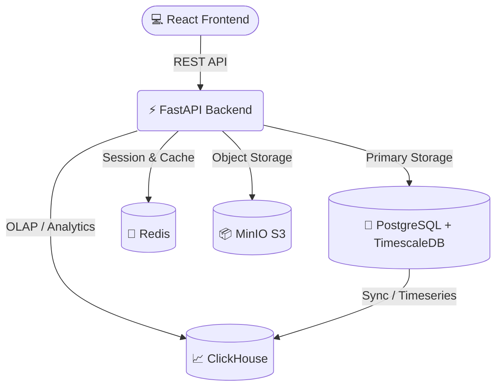

# 🧬 MorphoCheck Pro


**MorphoCheck Pro** is an advanced, AI-powered clinical anthropometry platform. It provides precise patient measurements, calculates BMI and complex growth indicators, and manages clinical recommendations. Designed for both clinical use and scientific research, it leverages a highly scalable modern microservices architecture.

---

## ✨ Key Features

- 🏥 **Clinical Anthropometry:** Detailed body measurements, calculating Z-scores, BMI, and ideal weight specific to age/gender norms.
- 🤖 **AI-Powered Diagnostics:** Integration with Machine Learning models and Google Gemini/GenAI for generating personalized tips and treatment advice.
- 📊 **Real-time Analytics Dashboard:** Aggregates and analyzes massive amounts of patient data instantly using **ClickHouse** and beautiful frontend charts.
- ⏱️ **Time-Series Tracking:** Built-in **TimescaleDB** capabilities for analyzing historical growth trends and patient progress tracking.
- 📑 **Automated Reporting:** Generate ready-to-print DOCX and PDF medical reports with a single click.
- 🔒 **Role-based Access:** Multi-tier authentication supporting Superadmins, Researchers, and ordinary Admins.

---

## 🏗 System Architecture

MorphoCheck Pro operates on a modern, decoupled architecture allowing for massive scalability.



---

## 💻 Technology Stack

| Component | Technology | Description |
| :--- | :--- | :--- |
| **Frontend** | React 18, TailwindCSS, Framer Motion | Dynamic, Glassmorphism UI with smooth animations and responsive design. |
| **Backend** | Python 3.11+, FastAPI | Extremely fast ASGI web framework for building the core RESTful APIs. |
| **Primary DB** | PostgreSQL 15, SQLAlchemy | Relational data handling with ACID compliance. |
| **Time-Series** | TimescaleDB | Extension for PostgreSQL optimizing historical metrics. |
| **Analytics** | ClickHouse | Lightning-fast column-oriented DBMS for the analytics dashboard. |
| **Caching** | Redis | In-memory key-value store to speed up frequent queries. |
| **Storage** | MinIO | S3-compatible object storage for PDFs, images, and backups. |

---

## 🚀 Quick Start (Recommended: Docker)

The easiest and recommended way to start MorphoCheck Pro in a production-like environment is via Docker Compose.

1. **Clone the repository:**
   ```bash
   git clone https://github.com/Shoxrux0803/morpho-check-app.git
   cd morpho-check-app
   ```

2. **Configure Environment:**
   Copy the example environment files and adjust them if necessary.
   ```bash
   cp morphocheck_backend/.env.example morphocheck_backend/.env
   ```

3. **Start the Infrastructure:**
   ```bash
   docker-compose up -d
   ```
   *This single command will pull and start PostgreSQL, ClickHouse, MinIO, Redis, the FastAPI backend, and the React frontend.*

4. **Access the Application:**
   - Frontend Web App: `http://localhost:3000`
   - Backend API Docs: `http://localhost:8000/docs`
   - MinIO Console: `http://localhost:9001`

---

## 🛠 Local Development (Fallback: SQLite)

If you cannot install Docker, you can run the application locally using SQLite as a fallback. Note that advanced features like ClickHouse Analytics and TimescaleDB will be disabled in this mode.

### 1. Backend Setup
```bash
cd morphocheck_backend
python -m venv venv
# Activate virtual environment (Windows)
.\venv\Scripts\Activate.ps1
# Install dependencies
pip install -r requirements.txt
```

Create a `.env` file in `morphocheck_backend/` with the following:
```env
DATABASE_URL=sqlite:///./morphocheck.db
CACHE_BACKEND=memory
MINIO_SECURE=false
```

Start Uvicorn:
```bash
python -m uvicorn main:app --reload --port 8000
```

### 2. Frontend Setup
In a new terminal:
```bash
cd ../ # Back to project root
npm install
npm start
```

---

## ⚙️ Environment Variables

Critical variables located in `morphocheck_backend/.env`:

- `DATABASE_URL`: Connection string. Use `postgresql+psycopg2://...` for Production or `sqlite:///./morphocheck.db` for local tests.
- `SECRET_KEY`: Keep this secure! Used for JWT signing.
- `GEMINI_API_KEY`: Required for generating AI parent tips.
- `CACHE_BACKEND`: `redis` (recommended) or `memory`.

---

## 🛡️ License & Contact

Developed for MorphoCheck platform. For support, issues, or contributions, please contact the repository administrator. All rights reserved.
